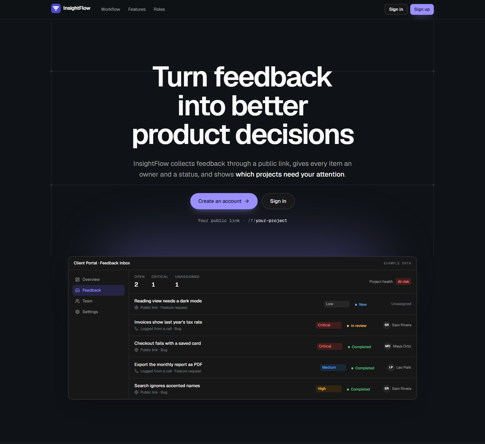
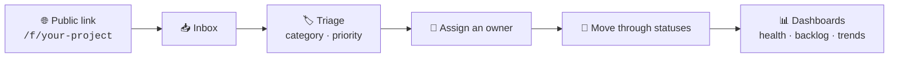

<div align="center">

<a href="https://insight-flow-theta-beryl.vercel.app/">
  
</a>

# InsightFlow

### Turn scattered feedback into clear, traceable product decisions.

Collect feedback through a public link, give every item an owner and a status,<br>
and see at a glance **which projects need your attention**.

<br>

<a href="https://insight-flow-theta-beryl.vercel.app/"></a>

<br><br>

[](https://github.com/Angel-oso/insight-flow/actions/workflows/ci.yml)


<br>

<a href="https://insight-flow-theta-beryl.vercel.app/">
  
</a>

</div>

<br>

## ✨ Why InsightFlow?

Feedback usually lives everywhere: support chats, forms, email, calls,
spreadsheets. So valuable requests get lost, nobody can tell a pattern from a
one-off opinion, and nobody remembers *why* something was prioritized.

InsightFlow gives teams **one simple workflow**:



Deliberately **simple before smart**: manual classification and
prioritization, with no AI magic and no black-box scoring.

## 🚀 Features

<table>
<tr>
<td width="50%" valign="top">

### 🌐 Public intake
Share one link and anyone can send feedback, **no account needed**.
Protected by Cloudflare Turnstile, a honeypot and rate limits, with optional
file attachments.

</td>
<td width="50%" valign="top">

### 📥 Smart inbox
Search, filter by status, priority, category, date or "assigned to me".
Server-side pagination, shareable deep links, internal notes and a full
activity trail.

</td>
</tr>
<tr>
<td valign="top">

### 📊 Decision dashboards
Received vs. resolved trends, backlog composition, a **"Needs intervention"**
queue, per-person workload and an organization-wide health table. Pick a
range of 7, 30 or 90 days, or custom dates.

</td>
<td valign="top">

### 👥 Teams & roles
Multi-tenant organizations and projects. Built-in **Admin**, **Manager** and
**Member** roles plus custom per-project roles, all enforced on the server.

</td>
</tr>
<tr>
<td valign="top">

### ✉️ Invitations & notifications
Expiring, one-time invitation links or email invites. Critical alerts and a
weekly digest, with one-click unsubscribe.

</td>
<td valign="top">

### 🎨 Polished UX
Real-time updates everywhere, light and dark themes, a fully responsive
layout, keyboard-friendly and accessible components.

</td>
</tr>
</table>

## 🔐 Security first

- **Every check runs on the server.** Identity comes from the auth session,
  never from arguments, and each read or write verifies project membership
  and role capabilities.
- **Sign-in with Google or email + password**, with email verification codes,
  password reset, and a captcha after failed attempts.
- **Abuse protection**: Cloudflare Turnstile and rate limits on public and
  auth endpoints.
- **Hardened headers**: nonce-based Content Security Policy, HSTS and frame
  protection.
- **Self-serve data deletion** for feedback, projects, organizations and
  accounts.

## 🛠️ Tech stack

| Layer | Technology |
| --- | --- |
| **Frontend** | Next.js 16 (App Router) · React 19 · TypeScript |
| **Backend** | Convex: database, server functions, realtime, file storage, crons |
| **Auth** | Convex Auth (Google OAuth + email/password) |
| **UI** | Tailwind CSS 4 · shadcn/ui · Base UI · Lucide icons |
| **Charts** | TanStack Charts |
| **Email** | Brevo transactional API |
| **Monitoring** | Sentry |
| **Testing** | Vitest + convex-test, with backend suites covering authorization, intake, auth and email |
| **Hosting** | Vercel (frontend) + Convex Cloud (backend) |

## 🏁 Getting started

> **Just want to look around?** Open the
> **[live demo](https://insight-flow-theta-beryl.vercel.app/)**, create an
> account, and send yourself feedback through your project's public link.

To run it locally you need **Node 20+** and **pnpm**.

```bash
git clone https://github.com/Angel-oso/insight-flow.git
cd insight-flow
pnpm install
cp .env.example .env.local
```

Run the backend and the frontend in two terminals:

```bash
npx convex dev   # Terminal 1: Convex backend (watch + codegen)
pnpm dev         # Terminal 2: Next.js at http://localhost:3000
```

Set the auth variables once on your Convex deployment: `JWT_PRIVATE_KEY`,
`JWKS`, `SITE_URL`, and optionally `AUTH_GOOGLE_ID` / `AUTH_GOOGLE_SECRET`.
`.env.example` explains each one.

| Command | What it does |
| --- | --- |
| `pnpm dev` | Next.js dev server |
| `pnpm build` / `pnpm start` | Production build and server |
| `pnpm test` | Backend test suites |
| `pnpm typecheck` | Typecheck the app and the Convex backend |
| `pnpm lint` | ESLint |

**Deploying your own copy?** The full runbook (Vercel + Convex, env vars,
OAuth, email, security checklist) lives in **[DEPLOYMENT.md](./DEPLOYMENT.md)**.

## 📚 Under the hood

<details>
<summary><b>🗺️ Routes</b></summary>

<br>

| Route | Audience | What it does |
| --- | --- | --- |
| `/` | Public | Landing page |
| `/login`, `/signup` | Public | Authentication |
| `/f/[projectSlug]` | Public | Feedback form and confirmation |
| `/invitations/[token]` | Signed in | Accept a project invitation |
| `/workspace` | Members | Projects list; organization overview for admins |
| `/workspace/settings` | Admins | Rename the organization, transfer ownership |
| `/projects/[slug]/home` | Members | Decision-ready project overview |
| `/projects/[slug]/feedback` | Members | Inbox: queue, detail, triage, notes |
| `/projects/[slug]/team` | Members | Workload, roles, invitations |
| `/projects/[slug]/settings` | Members | Identity, intake link, taxonomies, roles, archive |

</details>

<details>
<summary><b>🧱 Architecture</b></summary>

<br>

```text
app/
├── page.tsx                       → landing
├── (auth)/login, signup           → authentication
├── f/[projectSlug]/               → public feedback form
├── invitations/[token]/           → accept an invitation
├── workspace/                     → organization overview + settings
└── (app)/projects/[projectSlug]/  → home · feedback · team · settings

convex/
├── schema.ts         → tables and indexes
├── access/           → organization and project role resolution
├── feedback/         → queries, mutations, aggregates, single write path
├── intake/           → anonymous form read + submission
├── dashboard/        → overview metrics
├── organizations/    → overview, rename, ownership, deletion
├── projects/         → create, settings, roles, archive, deletion
├── team/  invitations/  taxonomies/  users/  attachments/
└── notifications/  email/  monitoring/
```

**Backend conventions**

- Identity always comes from the auth session (`getAuthUserId`).
- Index-driven reads (`withIndex`) and bounded collections (`take(n)`).
- `args` + `returns` validators on every function.
- Metrics come from `@convex-dev/aggregate`, so counts stay fast with tens of
  thousands of items. Every feedback write goes through
  `convex/feedback/store.ts`, which keeps the aggregates in sync.

</details>

<details>
<summary><b>🗃️ Data model and business rules</b></summary>

<br>

```text
organizations ─┬─ organizationMembers ── users
               ├─ projects ─┬─ projectMembers (user + role)
               │            ├─ projectInvitations
               │            └─ feedback ─┬─ comments
               │                         └─ activities
               └─ taxonomies (status · category · priority)

roles ── permissions   (built-in admin/manager/member + custom per-project roles)
```

The rules are the same in the backend and the UI:

- **Open**: any status not marked final.
- **Stale**: open with no activity for 7 days or more.
- **Needs attention**: open and top priority, unassigned, or stale.
- **Health**:
  - **At risk**: 1 or more open items at the top priority, or 20 or more open
    items.
  - **Needs attention**: any open backlog.
  - **Healthy**: nothing open.
- **Archived projects** are read-only until an admin restores them.

</details>

<details>
<summary><b>🛡️ Roles and permissions</b></summary>

<br>

| Role | Can |
| --- | --- |
| **Owner** | Everything an admin can, plus transfer ownership and delete the organization |
| **Admin** | Triage, assign, delete feedback; manage projects, team, roles, taxonomies and members |
| **Manager** | Triage, assign, update, comment and log feedback |
| **Member** | Comment on and update the status of feedback assigned to them |
| **Custom** | Any combination, defined per project |

Capabilities live in `lib/auth/permissions.ts` and are enforced in the
backend (`requireCapability`), never only in the UI.

</details>

<details>
<summary><b>🚫 Deliberately out of scope</b></summary>

<br>

Third-party integrations (Slack, Jira), AI summaries or deduplication, public
voting and roadmaps, billing, and CSV import/export.

</details>

---

<div align="center">

Built by **[Angel Osorio](https://github.com/Angel-oso)** as an end-to-end
product + engineering case study.

**[🌐 Open InsightFlow →](https://insight-flow-theta-beryl.vercel.app/)**

</div>
